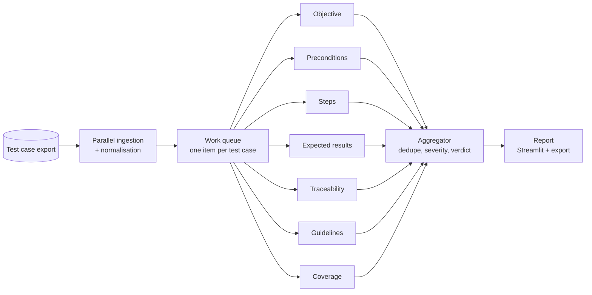

# 7-Agent Test Case Reviewer

> **Case study, not source code.** This repository explains *what* the system does and *how* it is designed.
> It contains no source code, no customer or project data, and no internal names. Examples are generic.
> Built by [Sumit Biranje](https://sumit-biranje-seven.vercel.app) as part of AI engineering work at KPIT Technologies.

**Replacing slow, inconsistent peer review of manual test cases with seven specialised AI reviewers that return
structured, actionable feedback.**

---

## The problem

Manually written test cases must be reviewed against writing guidelines and requirement traceability before use.
Peer review (L1 review) took senior engineers' time, varied from reviewer to reviewer, and became a bottleneck
whenever large batches of test cases arrived.

## What it does

1. **Ingests test cases in parallel** from exported test management data.
2. **Runs seven specialised review agents** on each case. Each owns one quality dimension, so no single prompt tries to judge everything.
3. **Returns structured findings** (Pydantic): what is wrong, where, how severe and a suggested fix.
4. **Aggregates** findings into a per-case verdict and a batch report.
5. **Presents** results in a Streamlit app for reviewers to accept, reject or edit.

## The seven reviewers (illustrative split)

| # | Agent | Checks |
|---|---|---|
| 1 | **Objective** | Is the objective clear, single-purpose and testable? |
| 2 | **Preconditions** | Are setup and initial state complete and unambiguous? |
| 3 | **Steps** | Are steps atomic, ordered and executable by someone new? |
| 4 | **Expected results** | Is every step's outcome observable and verifiable? |
| 5 | **Traceability** | Does the case link to the right requirement, and cover it? |
| 6 | **Guidelines & style** | Naming, terminology, template and formatting rules |
| 7 | **Coverage & duplicates** | Missing negative/boundary cases; overlap with existing cases |

## Architecture

Detail: [docs/architecture.md](docs/architecture.md) · decisions: [docs/decisions.md](docs/decisions.md).

## Key design ideas

| Idea | Why it matters |
|---|---|
| **One agent per dimension** | Focused prompts are more accurate and easier to tune than one big reviewer. |
| **Structured output everywhere** | Findings can be counted, filtered, deduplicated and tracked over time. |
| **Parallel by design** | Agents run concurrently per case; batches are ingested in parallel. |
| **Severity + suggested fix** | Feedback is actionable, not just "this is unclear". |
| **Human stays in charge** | The tool proposes; reviewers accept or reject in the UI. |

## Tech stack

Python (async) · OpenAI Agents SDK · Pydantic structured output · parallel ingestion (asyncio) · Streamlit.

## Outcome

Consistent, structured review feedback in place of slow, variable peer review. Senior engineers review the
findings instead of every line.

## Reusable for other teams

The same reviewer pattern fits code review checklists, document QA, compliance checks, content moderation and
grading. Any task where several independent criteria must be checked.

## Background & further reading (public)

- The **ISTQB** syllabus and **IEEE 829 / ISO/IEC/IEEE 29119-3** define what a good test case contains: objective, preconditions, steps, expected results and traceability. These are the dimensions the seven agents check.
- [OpenAI Agents SDK](https://openai.github.io/openai-agents-python/): the agent framework used, with structured outputs and parallel execution.
- Zheng et al., *Judging LLM-as-a-Judge with MT-Bench and Chatbot Arena*, NeurIPS 2023: strengths and limits of using LLMs as reviewers, and why narrow rubrics help.
- The pattern of several narrow checkers plus a deterministic aggregator mirrors well-established static-analysis tools (one rule per check, rules combined into a verdict).

---

*Diagrams and examples are illustrative. No proprietary code, data, metrics or customer information is included.*
