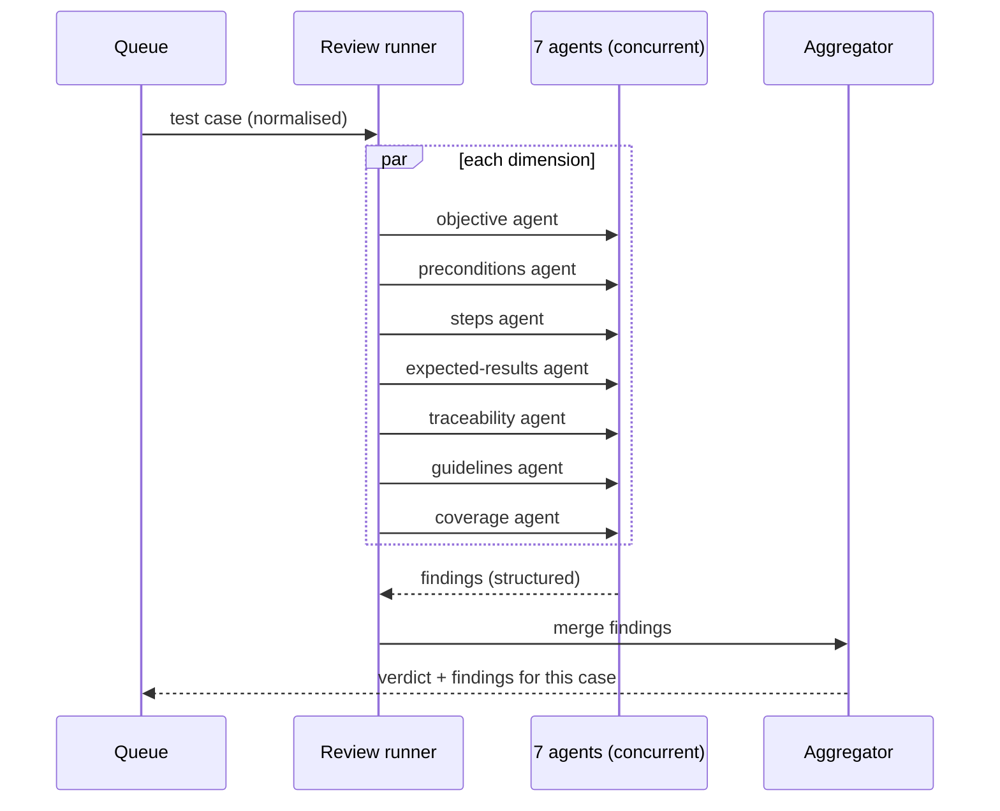

# Architecture

## Review of one test case



## Finding schema (Pydantic, simplified)

```python
class Finding(BaseModel):
    dimension: Literal["objective", "preconditions", "steps", "expected",
                       "traceability", "guidelines", "coverage"]
    location: str            # e.g. "step 4"
    severity: Literal["blocker", "major", "minor", "suggestion"]
    problem: str
    suggested_fix: str

class Verdict(BaseModel):
    test_case_id: str
    status: Literal["pass", "needs_changes", "reject"]
    findings: list[Finding]
```

## Example finding (illustrative)

```json
{
  "dimension": "expected",
  "location": "step 3",
  "severity": "major",
  "problem": "Expected result 'Radio works' is not observable.",
  "suggested_fix": "State the observable outcome, e.g. 'Station frequency on screen changes to the next station within 3 s'."
}
```

## Aggregation rules

- Identical problems found by two agents are merged.
- Verdict: any `blocker` → reject; any `major` → needs changes; otherwise pass.
- Batch report: counts by dimension and severity, plus the worst cases first.
